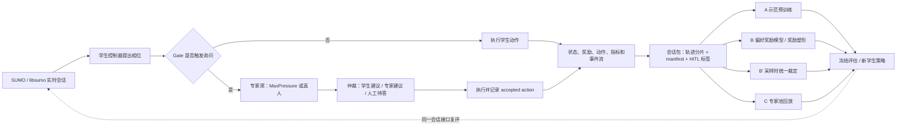

# 人在回路（HITL）交通信号控制：工作全景与汇报素材

> 用途：项目阶段汇报、组会和 PPT 内容组织。本文以仓内代码、设计记录、实验产物和台账为依据，提供可直接拆页的叙事、图表建议和可绘图数据。
>
> 范围：截至 2026-10-29 的 HITL 实时会话、数据资产生产、训练通道、验证结果和暖启动闭环。指标表里的正负方向均以“实验臂减对照臂”表示；旅行时间、未完成车辆数和 RRT 越低越好，吞吐量越高越好。
>
> 证据等级：S2 通道对照和多数跨场景结果属于探索性 pilot；warmloop 运行已进入 `ledger/runs.jsonl` 的 `hitl_warmloop` campaign，但其结果仍是有限场景上的验证，不等同于跨路网科研结论。文中的数据路径均为仓库相对路径；大体量结果位于 git 忽略的产物目录。

## 1. 一页摘要

本项目把人在回路从“实时看交通、人工接管”扩展成一条可记录、可审计、可用于训练的闭环。实时端以 SUMO/libsumo 运行信号控制；触发器决定何时询问专家；学生、虚拟专家或真人提出动作后，由仲裁器确定实际执行动作；录制器保存状态、动作、奖励和干预来源。会话录制随后被打包为训练可读档案，用于示范预训练、偏好奖励塑形、统一裁定或专家池回放，训练后的策略再回到相同会话接口进行演示和复评。

当前已形成四类训练机制：A 示范模仿预训练、B 偏好奖励塑形、B′ 采样时统一裁定、C 专家纠偏转移回放。实验得到一个较清楚的阶段性结论：在已测的单路口 pilot 中，调整学生初始策略的 A 通道和调整学习信号的 B/B′ 通道表现出较强的正向信号；把静态专家纠偏样本直接混入回放池的 C 通道，在小池、高比例设置下会伤害学习。集成 A+B 的 FULL 臂在主场景学习曲线的 AULC 上三项交通指标均改善，但最终旅行时间区间仍跨零。另一个暖启动闭环表明，面向分布偏移采集的接管示范可以把已有模型拉回接近 MaxPressure 的探针表现；普通在线续训会磨损这种效果。

这些证据支持“已经打通工程闭环、获得有边界的实验信号”，尚不支持“人在回路在一般路网和需求下稳定优于基线”。正式汇报应把工程成果、pilot 结论和待验证假设分层呈现。

## 2. 问题与目标

交通信号控制策略在训练分布之外可能遇到突发拥堵、车流方向失衡和学生策略尚未学会处理的状态。纯在线学习需要反复探索；静态离线数据又可能与当前状态分布不匹配。HITL 的目标是让专家在必要时介入关键决策，把专家信息转成可追溯的数据或学习信号，并验证这些信息是否能改善学生策略。

设计上把“在线控制”与“训练改进”分开：实时会话提供控制、询问和记录接口；训练方法消费会话产物。虚拟 MaxPressure 先作为可复现专家，真人专家使用相同的专家席协议。实际实现支持真人回答，但当前主要量化证据来自虚拟专家和 SUMO 仿真。

## 3. 系统工作流

### 3.1 在线会话层

- 仿真由 libsumo 驱动，网页通过 HTTP 提供控制入口、通过 SSE 接收实时帧。默认以 10 秒仿真决策间隔和 1 倍实时速度运行；会话可以调整速度、暂停、在决策点等待确认、切换控制器或手工选择相位。
- 内置控制器包括 FixedTime、MaxPressure、SOTL、DQN 快照和人工控制。地图支持 deck.gl WebGL 渲染，并保留 Canvas 渲染器作为兼容选项；多路口时控制器逐路口输出动作，可在地图和相位面板间切换路口焦点。
- Gate 支持 `periodic`、`on_demand`、`random`、`margin`、`window` 等询问时机。触发器带有每 episode 预算、冷却时间和受控路口资格检查。`margin` 根据学生动作价值差距估计不确定性；`window` 使用已知事件时间窗，作为询问时机的上界参照。
- 真人专家席在 gate 命中时展示当前路口、触发原因、学生建议、相位选项和倒计时。等待真人时可以冻结仿真；超时沉默仍按一次已消耗询问记录。虚拟专家即时返回动作。
- 另有场景引导调度控制器 `dsp`、`dspconcat`、`dspself`，按窗口选择候选控制器。它属于转播演示能力，不等同于 A/B/B′/C 的训练通道。

### 3.2 可追溯录制与数据打包

录制器按决策区间保存状态、相位、实际执行动作、区间奖励、下一状态、终止标记、控制器提案和 HITL 来源。`transitions.jsonl` 保存被执行的转移，`proposals.jsonl` 保存提案与仲裁结果，`interventions.jsonl` 保存人工固定相位、释放、gate 询问和回答等事件；`manifest.json` 记录场景、特征模式、动作维度和 episode 信息。每条转移关联实际动作和其产生的奖励，避免把“专家提议”误当成“已执行动作”。

打包器把一个或多个会话转换为与 Plan 1 trajectory 格式一致的分片，并附加数据集 manifest、HITL 行为标签、源分片索引和打包报告。它校验状态链连续性、动作/相位范围、奖励有效性、episode 边界、场景语义哈希和特征定义；不合格 episode 会被隔离并保留原因。最终档案可以由 `OfflineTrajectoryDataset` 直接读取，也可以生成 `expert_pool_manifest.json` 交给 sequential 专家池。

已记录的真实 SUMO 冒烟：S2 fixedtime 学生 + MaxPressure 专家，periodic(3) gate，运行 76 仿真秒得到 8 条转移；产物通过打包验证，观测维度为 16，专家接管转移被标记为 `hitl_expert_took_over`，数据集读取和统计正常。这证明录制到可读数据集的工程链可运行，不是训练效果证据。

## 4. 训练通道：做了什么、怎么做

| 通道 | 训练信号 | 实现方法 | 要检验的问题 |
|---|---|---|---|
| A：示范模仿 | 专家状态—动作示范 | 从档案生成示范数据；同一 ep0 DQN 权重初始化 actor/critic；分别测试不预训、仅 actor、仅 critic、actor+critic 双预训。DemoAC 共享 DQNNet 躯干。 | 示范能否提升初始策略；actor/critic 是否需要共同预训？ |
| B：奖励塑形 | 专家偏好或规则评分 | 把会话切成片段，构造偏好对并训练冻结奖励模型；B1 用确定性教师分，B2 用偏好模型分。在线训练时使用 `r' = r0 + λ·z`，其中评分经校准、裁剪，环境原始奖励继续用于评估。 | 专家偏好是否能提供比稀疏/延迟环境反馈更有效的学习方向？ |
| B′：采样时统一裁定 | 多个冻结判官的联合意见 | 转移只保存原始奖励和裁定特征；采样后在线、离线、专家三条腿统一经过同一判官面板。判官可为规则词条、偏好奖励模型和已收敛 Q-gap；规范化后合成有界分数。面板 manifest digest 绑定 checkpoint，防止恢复时悄悄更换判官。 | 奖励语义统一能否组合 B 与 C，并避免不同数据腿的奖励口径不一致？ |
| C：专家回放腿 | 专家介入产生的状态转移 | 从档案筛选纠偏转移，形成独立专家池；训练 batch 在 online/offline/expert 三腿中按独立配比采样。另设等量机器数据池和纯专家演示池，区分“专家质量”与“样本量增加”。 | 把局部接管转移静态重放，是否可以改善在线策略？ |

### 4.1 实验对照设计

- 主要单路口 pilot 使用相同初始 checkpoint、相同训练 seed、相同 episode 预算；通道差异作为唯一主要变量。A/B/C 初始版本每臂使用 5 seeds；典型训练长度为 20 episodes，每 episode 120 个决策点。
- C 通道另有等量机器数据对照，排除“只是多了数据”这一解释；纯专家控制池用于区分模仿收益与纠偏收益。
- B′ 的 BPC 组合臂同时使用裁定面板和专家池，用来检查统一奖励判分能否挽救 C 的表现。
- 主要汇总采用同 seed 配对的学习曲线面积（AULC）和终点冻结评测，报告 10,000 次配对 bootstrap 区间。工程过程量包括 gate 查询数、接管数、同意数、专家池样本使用量和 reward/judge fallback。
- 指标至少同报 `travel_time`、`throughput`、`unfinished_vehicles`；部分 pilot 另外报告仓内 RRT。travel time 和 unfinished 越低越好，throughput 越高越好；AULC 的方向按同一指标理解。

## 5. 实验结果

### 5.1 A 通道：actor+critic 双预训是强正向 pilot

S2/sumohz1x1 上 4 个 A 臂 × 5 seeds，共 20 个训练 run；各臂共享 ep0 初始权重和评估预算，示范预训 2,000 步。示范池约 244 条转移，来自 MaxPressure 控盘；这是 pilot 规模，低于原设计设想的 1,800 条。

| A 臂 | TT AULC Δ vs C0 | Throughput AULC Δ | Unfinished AULC Δ | RRT AULC Δ | 解释 |
|---|---:|---:|---:|---:|---|
| A0：DemoAC 不预训 | +18.55 | -59.70 | +1.30 | +55.40 | 整体弱于普通 DQN 基线；冷启动逐决策更新不稳 |
| Aπ：仅 actor | +70.88 | +97.87 | -48.48 | -75.97 | TT 显著退化，训练后期发散；只模仿策略而 critic 未对齐会破坏策略 |
| AQ：仅 critic | -4.12 | -49.45 | +1.58 | +50.83 | TT 小幅改善，但吞吐和 RRT 变差 |
| AπQ：actor+critic | **-23.25** | **+252.91** | **-86.25** | **-212.63** | 四项 AULC 指标均显著改善；收益从初始策略质量开始 |

AπQ 的 AULC travel time 为 81.8 秒，对照 C0 为 105.0 秒，约低 22%；第 20 episode 冻结评估为 79.4 秒，低于 MaxPressure 单独控制的 83.7 秒。终点配对结果也为四项指标显著改善：travel time Δ=-7.6（记录区间 [-19.5,-1.0]），RRT Δ=-81.1（[-137.6,-46.8]），throughput Δ=+106.0（[+58.4,+182.6]），unfinished Δ=-78.2（[-99.2,-58.4]）。

**可讲结论：**示范预训练的关键在于 actor 和 critic 成对初始化；单独 actor 模仿并不安全。限制是单场景、近饱和需求、小示范池且训练/评测同域，尚未证明跨场景泛化。

### 5.2 B 通道：冻结偏好奖励模型给出正向学习速度信号

B1/B2 共 10 个 run（每臂 5 seeds），与 C0 使用相同初始权重和训练预算，塑形系数 λ=0.1。偏好奖励模型使用 episode 级留出和早停；主场景留出集严格偏好准确率为 94.6%。跨场景零样本准确率见 5.6 节。

| B 臂 | Travel time AULC Δ | Throughput AULC Δ | Unfinished AULC Δ | RRT AULC Δ | 判读 |
|---|---:|---:|---:|---:|---|
| B1：规则教师评分 | -1.56，CI [-3.3,+0.2] | +16.90，CI [-6.9,+42.7] | +1.30 | -16.59，CI [-39.5,+3.0] | 方向弱，区间跨零 |
| B2：冻结奖励模型 | +1.90，CI [-2.7,+7.9] | **+31.11，CI [+8.5,+53.7]** | +0.04 | **-27.32，CI [-48.1,-6.6]** | AULC 的 throughput 与 RRT 为正向信号，TT 和 unfinished 中性 |

B2 的最终 RRT 差值区间仍跨零（记录为 Δ=-23.5，CI [-77,+11]），所以可支持“学习期间的累计表现改善”，不能直接说最终收敛结果更好。塑形信号的量级约为基础奖励的 0.3%，fallback 计数为 0，改善更像来自奖励方向/形状，而非大幅改写环境目标。

### 5.3 B′ 通道：统一裁定能复现部分 B2 信号，但没有证明判官团优于单判官

B′ 在 `sumohz1x1` 做 2 episode 冒烟和 5-seed 配对 pilot。冒烟中 online 与 expert 两条腿均完整使用相同 manifest；缺特征和 judge fallback 均为 0。5-seed 配对训练共 10 个 run（BP/BPC），21,600 个更新窗的裁定块覆盖率 100%，判官面板在 expert 腿与 online 腿上的评分分布方向符合预期。

| B′ 臂 | TT AULC Δ vs C0 | Throughput AULC Δ | Unfinished AULC Δ | RRT AULC Δ | 结论 |
|---|---:|---:|---:|---:|---|
| BP：统一判官，仅在线腿 | +0.49，中性 | **+21.66，CI [+1.7,+38.9]** | +0.41，中性 | **-19.20，CI [-35.2,-2.1]** | 复现 B2 的吞吐/RRT 改善模式，幅度约为 B2 的 2/3 |
| BPC：统一判官 + 专家池 | +5.78，偏差 | -16.25，偏差 | +2.68，偏差 | +13.68，中性 | 没有救活静态专家池回放 |

因此“奖励口径混杂导致 C 失败”不受 BPC 结果支持；已有证据更符合“静态纠偏转移的分布偏移”解释。该解释仍是机制假设，需更多状态覆盖和诊断实验确认。未完成项包括判官预测效度、分歧矩阵、逐判官消融、BP 与 B2 直接配对及聚合权重选择。

### 5.4 C 通道：小型静态纠偏池会伤害学习，增加专家池样本量本身未解决问题

早期配对 pilot 共 20 run（C0/EXP/CTRL/DEMO × 5 seeds），20 episodes，专家腿配比 25%，纠偏池 243 条。对照 C0 的 AULC 差值如下；正负方向按各自指标的优劣解释：

| 指标 | EXP：纠偏池 | CTRL：等量机器数据 | DEMO：纯专家池 |
|---|---:|---:|---:|
| Travel time | **+11.80**，CI [+2.0,+26.1]，p=0.004 | **+11.47**，CI [+0.5,+22.8]，p=0.017 | +1.25，中性 |
| Throughput | **-20.69**，CI [-36.4,-5.0]，p=0.992（劣化方向） | -3.13，中性 | +0.38，中性 |
| Unfinished vehicles | +3.45，CI [-1.2,+8.1]，p=0.076 | **+4.88**，CI [+1.4,+8.8]，p=0.000（劣化方向） | +1.61，中性 |
| RRT | **+19.23**，CI [+3.4,+34.1]，p=0.007（劣化方向） | +0.36，中性 | -0.05，中性 |

EXP 的 travel time、throughput 和 RRT 有明确负向证据；unfinished 的区间跨零。等量机器数据臂也有 travel time 与 unfinished 的负向结果。因此这组结果不能归因为“专家动作质量差”，更直接的证据是“小型静态数据池以高比例混入”会造成训练分布冲击。

后续把纠偏池扩至约 2,190 条/18 会话，并测试 5%/25% 配比、衰减比例及 gate 筛选池；这些作为增补 pilot 留档。BPC（裁定面板+专家池）仍未改善，说明仅更换奖励判分口径不足以消除数据分布问题。

**适合 PPT 的机制图：**一张左侧展示 gate 只在拥堵边界询问，右侧展示小池在随机 replay 中被反复抽样；标注早期设置 243 条、25% 专家腿、约 142 倍过采样。再并列画等量机器数据 CTRL，强调“静态数据量增加”也是候选解释。

### 5.5 集成系统 FULL：主场景学习曲线总体改善，最终旅行时间仍不确定

主场景 `bc-tyc` 的 5-seed 评估将 FULL 定义为 **A 示范预训练 + B 偏好奖励塑形**。已有代码和对照记录明确说明：FULL 的 DemoAC 路径没有接入 C 专家池腿；因此此处的 FULL 是 A+B 集成，不应描述成 A+B+C 全通道系统。另有单通道臂和等量数据对照。

| FULL vs C0 | AULC Δ（均值，记录的 CI） | 终点 Δ（均值，记录的 CI） | 解读 |
|---|---:|---:|---|
| Travel time | **-18.04**，[-26.23,-9.86] | -7.10，[-19.56,+0.59] | 累计学习表现改善；最终 TT 区间跨零 |
| Throughput | **+251.37**，[+200.83,+303.15] | **+106.2**，[+58.2,+182.4] | 累计与终点均改善 |
| Unfinished vehicles | **-85.89**，[-92.36,-79.42] | **-78.4**，[-99,-58] | 累计与终点均改善 |
| RRT | **-209.78**，[-255.87,-165.02] | **-80.26**，[-137.80,-43.78] | 仓内辅助指标累计与终点均改善 |

以上为探索性主场景证据，5 seeds、每个 episode 冻结评估；“统计显著”只针对表内对应配对区间。若要对外讲成整套方法有效，仍需确认 FULL 系统的多场景对照和 C 腿接入后的重新评估。

### 5.6 跨场景复现与奖励模型迁移

r3 多场景设计把代表通道放到三个不同杭州单路口流量配置：qc-yn（1,417 辆）、kn-hz（743 辆）、sb-sx（1,671 辆）。每场景设置 C0、A 双预训 APIQB、B 奖励塑形 B2、C 大纠偏池 EXPB，各 5 seeds；结果汇总比较的是各场景相对自身 C0 的 AULC 差。下表为实验臂减 C0，括号为记录区间。

| 场景 | 方法 | Travel time Δ | Throughput Δ | Unfinished Δ |
|---|---|---:|---:|---:|
| qc-yn | A：APIQB | **-43.13** [-49.70,-36.56] | **+153.20** [+135.89,+170.51] | **-67.77** [-73.74,-62.41] |
| qc-yn | B：B2 | +0.22 [-10.49,+10.94] | +14.02 [-2.53,+30.54] | -3.97 [-8.47,+0.53] |
| qc-yn | C：EXPB | **-5.01** [-6.42,-2.92] | +4.38 [-6.76,+16.61] | **-2.92** [-5.78,-0.31] |
| kn-hz | A：APIQB | **-43.57** [-52.88,-36.25] | **+33.42** [+27.13,+40.13] | **-26.87** [-30.01,-23.61] |
| kn-hz | B：B2 | **-4.10** [-6.39,-1.70] | **+3.78** [+0.76,+6.80] | **-2.22** [-3.80,-0.38] |
| kn-hz | C：EXPB | -2.68 [-8.82,+4.11] | +3.15 [-2.35,+8.03] | -3.11 [-5.72,+0.61] |
| sb-sx | A：APIQB | **-46.28** [-57.26,-35.31] | **+124.82** [+102.98,+148.82] | **-58.74** [-69.30,-51.57] |
| sb-sx | B：B2 | **-10.08** [-18.97,-1.82] | +24.19 [-3.71,+52.08] | **-8.65** [-15.21,-2.59] |
| sb-sx | C：EXPB | -2.66 [-12.32,+5.07] | +13.94 [-4.78,+34.94] | -2.09 [-9.14,+3.27] |

可见 APIQB 在三个跨流量场景的三项指标区间均为改善；B2 在 kn-hz 和 sb-sx 的 TT/unfinished 有改善，在 qc-yn 没有清晰信号；C 大池在各场景效果较弱且多个区间跨零。这个多场景结果支持“示范预训练更稳健、奖励模型有条件迁移、纠偏池回放不稳”的暂时排序。它不是 FULL 系统的跨场景验证：r3 表格评的是单通道代表臂。

偏好奖励模型严格准确率：主场景留出集 94.6%；零样本迁移到 qc-yn 为 78.7%（2,400 对）、kn-hz 为 83.3%（2,400 对）、sb-sx 为 80.8%（2,400 对）。模型保留了一定跨场景排序能力，但与环境奖励的相关性仅中等，不能视为环境奖励的替代品。

### 5.7 Gate 成本与询问收益

五种询问策略各 10 个会话，使用同一类突发流量注入。每集平均查询数为 4.2–8.1，约为预算上限 36 次的 12%–23%；按典型 120 个决策点折算，询问占比约 3.5%–6.8%。

| Gate | 查询/episode | 接管/episode | 接管率（takeover/query） | 事件窗内询问比例 | Travel time 均值 | Throughput 均值 | Unfinished 均值 |
|---|---:|---:|---:|---:|---:|---:|---:|
| on_demand | 4.2 | 2.1 | 0.50 | 0.227 | 79.59 | 642.3 | 37.2 |
| random | 8.1 | 4.2 | 0.52 | 0.187 | 79.16 | 643.7 | 37.7 |
| margin | 6.2 | 4.2 | **0.68** | 0.195 | 78.93 | 642.1 | 38.2 |
| periodic | 7.0 | 3.2 | 0.46 | 0.286 | 79.91 | 643.1 | 38.1 |
| window | 7.0 | 3.1 | 0.44 | 1.000 | 80.63 | 643.1 | 37.9 |

`margin` 在这批采集中以约 6.2 次查询取得最高接管率，成本—命中效率较好；这组表是会话触发/接管统计，不足以证明它能带来显著的训练收益。`window` 是 oracle 事件窗参照，100% 落在已知 300–600 秒事件窗口内，但并不代表可部署时有同等先验。

### 5.8 暖启动闭环：先采集分布偏移接管，再用示范修复策略

warmloop 解决的问题更贴近“已有模型如何吸收 HITL”：从既有模型 M0 出发，冻结评估并用 M0 与 MaxPressure 探针；让 M0 在同 seed/同场景下运行，MaxPressure 仅在 gate 触发时介入；按 seed 打包纠偏池；把 M0 权重和优化器作为 warm-init，清空旧 replay 与 episode 计数；专家池续训产出 M1；最后用同条件学生探针配对比较 M0/M1。

campaign 台账覆盖 5 seeds 的 M0 基线、C 专家池续训、A 示范预训练及续训阶段；WA2、WA3、WA4 各记录 5 个 DONE run。核心阶段读数如下：

| 阶段 | 训练/数据变化 | 探针结果 | 含义 |
|---|---|---|---|
| WA2 | 在 M1 暖启动后做 actor+critic 示范预训练并续训 20 episodes | TT 109.6 s、throughput 522、unfinished 93、终点 queue 54；对照探针 A0 为 TT 95.5 s、throughput 425、unfinished 181、queue 137；MaxPressure 参考 TT 83.8 s、throughput 644、unfinished 41、queue 9 | 示范将排队和未完成车辆压低，但策略仍明显落后专家；ledger notes 同时记录 A1/actor-only 的在线阶段 4/5 seeds 在 ep10 后塌缩 |
| WA3 | 接入 C 通道并继续训练 30 episodes | 训练内评估 queue 约 11–15、TT 约 80–84；突发 probe 上 queue 64、TT 176.6 s | 训练内可贴近专家，但分布偏移下回退，普通 TD 更新会磨损初始示范策略 |
| WA4 | 针对 surge 接管采集；累计示范池约 430 条/seed，再做 A 示范预训练 | queue 17、TT 86.2 s、throughput 636、unfinished 46；MaxPressure 参考 queue 9、TT 83.8 s、throughput 644、unfinished 41 | 针对目标状态的接管数据把 probe 拉回专家附近；仍有小幅差距，尚未证明跨 seed/路网普适性 |

另一个 WEXP 记录为 M0 暖启动 + per-seed HITL 池（目标 expert_ratio 0.15，实际 0.156，池 unique=731）续训 20 episodes，对 25 对 M1-M0 配对评估报告：travel time Δ=+5.41（CI [-7.45,+14.13]）、throughput Δ=+68.0（CI [-5.76,+145.88]，另记 p≈0.04）、unfinished Δ=-30.7（CI [-57.0,-4.6]，另记 p≈0.009）。CI 与附记 p 值在 throughput 项上不完全一致，而且 travel-time Δ 为正；汇报时应展示原始区间，避免将整组 WEXP 说成三指标一致显著改善。WA4 是目前更直观的目标分布修复证据。

### 5.9 证据状态汇总

| 层次 | 当前状态 | 可以说什么 | 暂时不能说什么 |
|---|---|---|---|
| 工程功能 | 已实现并有针对性测试/冒烟 | 实时播放、人工接管、gate、录制、审计和打包链已连通 | 工程闭环成立不等于算法有效 |
| 训练机制 | A/B/B′/C pilot 均已实现 | 可以比较示范、奖励、裁定和回放等不同人源学习信号 | 所有通道都优于基线 |
| 单场景实验证据 | 5-seed 配对 pilot；FULL 主场景 AULC 正向 | AπQ 与 A+B FULL 在若干主指标有稳定学习期改善；小型静态 C 池有负证据 | 终点指标全部改善、效果与场景无关 |
| 跨场景证据 | 三个新流量配置做代表臂复现 | A 示范通道跨三个配置稳定；B 有场景差异；C 大池收益弱 | FULL 集成系统已跨场景证实 |
| 研究结论 | 初步机制线索 | 人源信息应优先改变策略起点或学习信号；局部接管转移要处理分布偏移 | 真人参与优于虚拟专家、HITL 在实际道路有效 |

## 6. 可直接用于 PPT 的叙事顺序

建议 10–12 页，按“为何要做 → 怎么做 → 关键证据 → 结论边界”展开。

| 页 | 标题 / 核心句 | 主图建议 | 需要讲清楚的点 |
|---:|---|---|---|
| 1 | 从实时接管到可复用的学习信号 | 一张真实转播界面截图或交通地图实时帧 | HITL 是闭环方法与工具链，不只是网页演示 |
| 2 | 现有策略在关键状态和分布偏移下需要专家纠偏 | M0/M1/MaxPressure 队列轨迹对比 | 问题是策略状态分布和能力缺口，不是“缺少一个人工按钮” |
| 3 | 实时控制、专家仲裁、会话录制构成在线闭环 | 第 3 节 Mermaid 工作流重绘 | 谁提出动作、何时问人、最终执行了什么必须可追溯 |
| 4 | 一份会话可以派生三种训练资产 | Session → demo / preference pairs / correction pool 三分图 | 三种资产不是同一学习信号，后续要分别验证 |
| 5 | 四种训练机制对应四种作用位置 | A/B/B′/C 机制表改为策略起点、奖励、采样裁定、经验池四栏 | 把机制定义与实验假设对应起来 |
| 6 | 双预训示范通道是单场景最强正向信号 | A0/Aπ/AQ/AπQ 的三指标曲线或四指标 forest plot | actor-only 失败、actor+critic 双预训有效；明确 pilot 边界 |
| 7 | 偏好奖励塑形改善学习速度，但终点优势未坐实 | B2 对 C0 的 AULC forest plot，加最终 TT CI 跨零注释 | 区分 AULC 与 final checkpoint，不把一个替代另一个 |
| 8 | 静态小纠偏池的主要风险是数据分布冲击 | EXP vs CTRL 配对图；数据池采样/状态分布示意 | 等量机器池也受损；高比例重复抽小池容易偏离 online state distribution |
| 9 | A+B 集成 FULL 改善累计表现，TT 终点仍不确定 | FULL vs C0 主场景 3 指标曲线，阴影为 5-seed SEM | FULL 当前定义只含 A+B，C 没接进 DemoAC 路径 |
| 10 | 跨场景结果支持示范泛化，奖励与回放效果依场景变化 | 3 场景 × 3 方法 heatmap / forest plot | 不把单通道代表臂结果说成 FULL 跨场景复现 |
| 11 | Gate margin 用较少询问取得较高接管命中率 | queries/ep 与 takeover yield 双轴散点或气泡图 | 这是采集效率证据，不是训练收益证明 |
| 12 | 暖启动闭环把策略拉回目标分布附近 | M0 → M1 → targeted takeover → A4 的队列曲线 | 分布偏移会磨损策略；目标状态示范有修复价值；下一步做更广泛验证 |

汇报主结论推荐表述：**“我们完成了从在线专家接管到训练可消费档案的闭环，并比较了四类人源学习信号。当前 pilot 显示，双预训示范和偏好奖励塑形最有希望；静态纠偏回放存在明显分布风险。暖启动探针表明，面向目标事件采集的接管示范可以修复策略在分布偏移下的表现，但跨场景与正式效应仍待验证。”**

## 7. 图表制作规格与数据源

### 7.1 推荐图表

1. **系统架构图**：左到右分成在线会话、录制资产、训练消费、冻结评估四层；实线表示数据流，虚线表示训练后策略回到会话复评。真人席与虚拟专家画在同一个专家席模块内。
2. **A 通道学习曲线**：x 轴按训练决策数（每 episode 120 决策），y 轴 TT / throughput / unfinished；显示 5-seed 均值和 SEM。TT 低为好，另两项按各自方向标注。
3. **单场景通道 forest plot**：以 C0 为零线，展示 5-seed 配对 bootstrap 的 AULC Δ 和记录区间；分面显示 TT、throughput、unfinished、RRT。
4. **跨场景 heatmap**：行是 qc/kn/sb × 方法，列是三项 AULC Δ；使用以 0 为中点的发散色标，并单独标注区间是否跨零。
5. **暖启动队列曲线**：M0、MaxPressure、M1 三条时间序列，均值线 + SEM 阴影；事件注入窗背景着色，gate 询问和实际接管用不同符号标记。
6. **Gate 成本—收益图**：x=queries/episode，y=takeover_yield，点大小可映射 travel_time；窗口命中率单独以颜色或标签编码，不能把 window oracle 解释成可部署策略。

### 7.2 可绘图数据摘要

以下表格可复制到绘图脚本。跨场景完整区间见第 5.6 节；单场景 FULL 数值见第 5.5 节。

#### 主场景 AULC 对照

| 臂 | TT Δ | Throughput Δ | Unfinished Δ | RRT Δ |
|---|---:|---:|---:|---:|
| A0 | +18.55 | -59.70 | +1.30 | +55.40 |
| Aπ | +70.88 | +97.87 | -48.48 | -75.97 |
| AQ | -4.12 | -49.45 | +1.58 | +50.83 |
| AπQ | -23.25 | +252.91 | -86.25 | -212.63 |
| B1 | -1.56 | +16.90 | +1.30 | -16.59 |
| B2 | +1.90 | +31.11 | +0.04 | -27.32 |
| BP | +0.49 | +21.66 | +0.41 | -19.20 |
| BPC | +5.78 | -16.25 | +2.68 | +13.68 |

说明：A 通道数字来自 2026-10-09 pilot 配对分析；B 来自 2026-10-09；B′ 来自 2026-10-11。不同阶段图的 bootstrap 区间数据源分别见实验设计记录产物，不应将不同臂的结果跨日期拼成一次统一正式实验。

#### Gate 采集统计

| mode | queries_per_episode | takeovers_per_episode | takeover_yield | in_event_window_fraction |
|---|---:|---:|---:|---:|
| on_demand | 4.2 | 2.1 | 0.500 | 0.227 |
| random | 8.1 | 4.2 | 0.519 | 0.187 |
| margin | 6.2 | 4.2 | 0.677 | 0.195 |
| periodic | 7.0 | 3.2 | 0.457 | 0.286 |
| window | 7.0 | 3.1 | 0.443 | 1.000 |

### 7.3 可复用仓内图表与产物

- `hitl/figs/deck_figs.py`：主场景系统消融、偏好模型准确率和跨场景系统曲线图。
- `hitl/figs/hitl_arch_fig.py`：在线会话—数据资产—训练层架构图。
- `hitl/figs/hitl_score_fig.py`：A/B/B′/C 多臂 AULC 配对区间 forest plot。
- `hitl/figs/multiscene_table.py`：多场景 AULC 汇总。
- `hitl/figs/gate_modes_table.py`：gate 触发/接管效率汇总。
- `hitl/figs/curve_figs.py`：早期 C 通道 pilot 学习曲线及专家池消耗诊断。
- `dev/hitl_warmstart/fig_queue_compare.py`：M0、MaxPressure、M1 队列过程曲线。
- `data/output_data/hitl_probe/`：忽略目录中的会话、档案、paired bootstrap、图表与 warmloop 产物。它们是当前工作区的分析输入，不会随 Git 自动发布；重现汇报图前应检查对应 plan、run 和 summary 时间戳。

## 8. 局限、风险与下一步

- **证据层级**：绝大多数 A/B/B′/C 结果来自单路口 pilot、小池和有限训练长度。除非有登记的完整正式实验和更广的复现，不要用“证明有效”表述。
- **真人证据**：真人专家席的交互、超时、接管和录制协议已经实现；当前量化结果主要是虚拟 MaxPressure。还没有真人参与能提升控制结果的对照证据。
- **场景外推**：跨场景结果是 qc/kn/sb 单路口配置，需求量不同但拓扑相近；不是跨城市、跨路网或真实道路验证。
- **C 通道分布偏移**：gate 触发样本集中在拥堵边界。小型纠偏池经高比例回放可能远超其独立状态覆盖；应研究持续更新池、降低比例、按事件/状态覆盖采样或训练期在线询问。
- **B′ 判官质量**：统一裁定接口可用，但判官间分歧、预测效度和权重校准仍需独立审计；BPC 负结果说明奖励统一本身不足以解决专家池分布问题。
- **FULL 定义**：当前 FULL 是 A+B；专家池 C 未接入 DemoAC 的集成路径。对外展示前要在图例、标题和摘要中说明。
- **统计口径**：AULC 与终点回答不同问题；配对区间跨零时不应称显著。WEXP 台账的 throughput 记录同时包含跨零区间和 p≈0.04，需要回看原始 paired summary 后再用于显著性结论。
- **下一步优先级**：先把 A+B FULL 的多场景结果和配置/产物一一对齐；为 C 做更大、更分散的目标状态池与低配比/衰减对照；针对 shift 做事件前—中—后分层；补齐真人采集的成本、同意率、接管率和配对评估；统一汇报三项强制交通指标与完整 seed 级置信区间。

## 9. 复现入口与证据定位

| 目的 | 入口或事实源 |
|---|---|
| 启动浏览器实时转播 | `python -m hitl.serve --scene S2 --port 8010`；常驻托管可用 `hitl/live/supervise.sh` |
| 人工席 / gate / 录制 | `hitl/live/cli.py` 参数；功能实现位于 `hitl/live/engine.py`、`gate.py`、`recorder.py`、`server.py` |
| 打包会话档案 | `python hitl/pipeline/package.py --session <session_dir> --out <archive_dir> --network <network>` |
| A/B/B′/C pilot plan | `hitl/plans/build_pilot_plan.py`；训练由 `python -m sequential run-child` 执行 |
| 配对 bootstrap | `hitl/probe/paired_bootstrap.py`；配对训练/会话评估器见 `hitl/probe/paired_probe.py` |
| 设计与通道结果 | `docs/plan_hitl_live.md`，尤其 A/B/B′/C pilot 和 recorder/packager 章节 |
| 工作台账事实 | `ledger/runs.jsonl` 的 `campaign=hitl_warmloop`；阶段性脚本、产物和方法索引见 `dev/INDEX.md` 的 HITL 条目 |
| HITL 方法包说明 | `hitl/README.md` |
| 工程回归测试 | `tests/test_sumo_live_broadcast.py`、`tests/test_hitl_packager.py`、`tests/test_hitl_segments.py`、`tests/test_demo_ac.py`、`tests/test_adjudication.py` |

**讲稿最后一页建议：**系统链路已经从“专家能否接管”推进到“接管能否形成可用学习信号”；当前最可靠的实验线索来自策略起点和奖励信号，静态回放池的收益受状态分布影响。下一阶段应围绕目标状态覆盖、跨场景 FULL 复现和真人成本效益来收敛研究问题。
